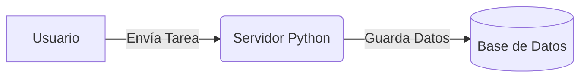

# Sistema de Tareas API


Una API sencilla para crear y organizar tareas pendientes. Diseñada para desarrolladores que necesitan ordenar sus flujos de trabajo rápidamente.

## Índice
* [Requisitos](#requisitos)
* [Instalación](#instalación)
* [Uso](#uso)
* [Flujo del Proyecto](#flujo-del-proyecto)
* [Hoja de Ruta](#hoja-de-ruta)
* [Contribución](#contribución)
## Requisitos

| Herramienta | Versión | Uso |
| :--- | :---: | :--- |
| **Python** | 3.10+ | Lógica del servidor |
| **SQLite** | 3.0+ | Base de datos local |

## Instalación

1. Descarga el proyecto:
```bash
git clone https://github.com/cesarpoblete-cmd/lab5.git 
cd lab5
```

## Uso

Ejecuta el servidor con este código de Python:
```python
# main.py
print("Iniciando el servidor de tareas...")
# Aquí se ejecuta la API
```

Para crear una tarea, envía este formato:
```json
{
  "titulo": "Estudiar para el laboratorio",
  "estado": "pendiente"
}
```

## Flujo del Proyecto



## Hoja de Ruta
- [x] Crear base del proyecto.
- [x] Configurar la base de datos.
- [ ] Agregar sistema de usuarios.

## Contribución
Lee la [guia de contribucion](CONTRIBUTING.md) antes de enviar cambios.